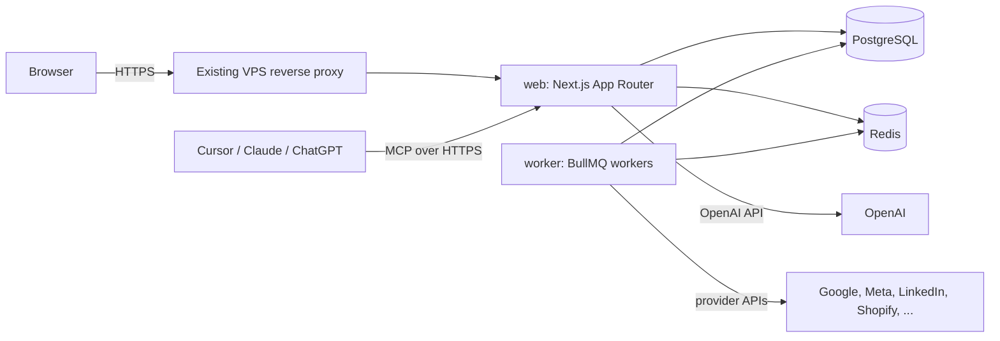

# Architecture

## Processes



| Process | Responsibility |
| --- | --- |
| `web` | UI, server actions, route handlers, OAuth callbacks, webhooks, AI routes, MCP endpoint, health checks |
| `worker` | All provider syncs and backfills, scheduled jobs, issue rules, signals, insights, report PDFs, notifications, retention purges |
| `postgres` | System of record: configuration, credentials (encrypted), facts, issues, reports, knowledge, audit |
| `redis` | BullMQ queues, locks, rate-limit counters, short-lived caches |

The web process never calls provider APIs during a page request, apart from OAuth exchanges and "list available sources" during mapping. Pages read from PostgreSQL only, so a slow or failing provider never slows the UI.

## Request flow (reading a dashboard)

1. Middleware checks the session.
2. The Server Component calls `requireCapability("viewClient", clientId)`.
3. It calls `metricsService.get({ clientId, scope, range, compare, metricKeys })`.
4. The metrics service reads `MetricFactDaily` through `queryFacts`, applies the metric registry (derived metrics, comparison, judgement, currency) and attaches freshness from `DataSource`.
5. Components render `MetricResult` objects. They never compute business logic.

## Sync flow

1. A job scheduler enqueues `sync` jobs per `DataSource` on the provider's cadence.
2. The worker takes a per-source lock, loads and decrypts the connection's credentials, and calls `provider.sync({ source, from, to })`.
3. The provider returns normalised, zod-validated facts plus `dataThrough` and warnings.
4. The worker upserts facts in batches, writes a `SyncRun`, updates the source's freshness and releases the lock.
5. A follow-up job runs the issue rules and signals for affected clients.
6. Errors are classified (AUTH, RATE_LIMIT, TRANSIENT, PERMANENT) and handled as described in `integrations/README.md`.

## Folder layout

```
src/app/                  routes
src/components/ui/        shadcn primitives
src/components/pulse/     design-system components
src/components/shell/     sidebar, top bar, palette, AI panel
src/features/<feature>/   feature UI and feature-specific server queries
src/lib/                  shared utilities (format, date-range, metrics registry and compare)
src/server/               server-only: db, env, auth, permissions, crypto, facts, metrics-service
src/server/providers/     one folder per provider plus types.ts and index.ts
src/server/jobs/          queues, schedulers, job handlers
src/server/issues/        rule framework and rules
src/server/ai/            context, schema, client, evidence check
src/server/mcp/           MCP server, auth, tools
worker/                   worker entry point
prisma/                   schema, migrations, seed
docs/                     these documents
tests/e2e/                Playwright
```

## Key design rules

- **Facts, then metrics.** Providers write raw daily facts. Derived metrics (rates, ratios, MER, CPL) are always computed from summed inputs at query time, never stored and never averaged.
- **Tiers travel with values.** Every fact has a tier. The metrics layer refuses to add values across tiers or ad platforms.
- **Freshness is data.** `DataSource.status`, `lastSuccessfulSyncAt` and `dataThrough` are part of every metric result.
- **Missing is not zero.** A missing day or unavailable input is returned as missing with a reason.
- **Secrets stay server-side.** Credentials are encrypted at rest and only decrypted inside the worker or server-only modules.
- **One way to check permission.** All access goes through `src/server/permissions.ts`.
